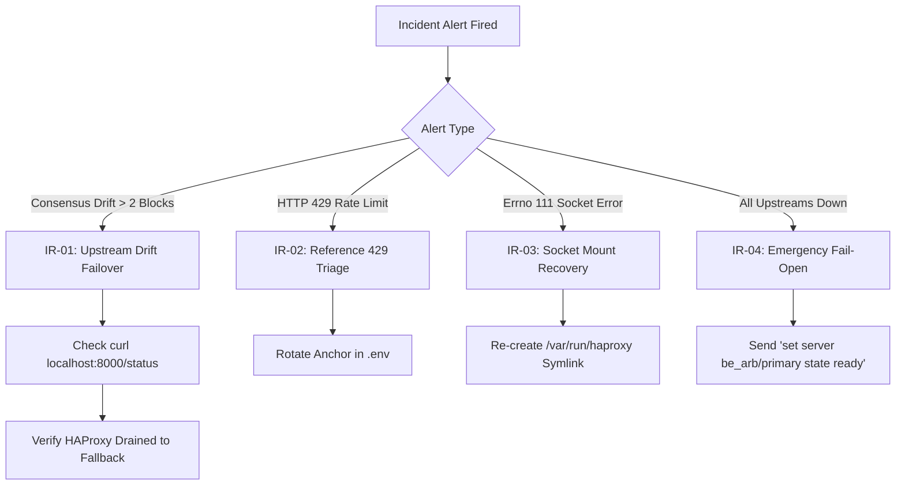

# DriftGuard Multi-Node Cluster: Standard Operating Procedure (SOP)

**Document ID:** `DG-SOP-OPS-001`  
**Classification:** Production Infrastructure Runbook  
**Target Audience:** Infrastructure Engineers, SREs, Devops Specialists, On-Call Operators  
**Effective Date:** October 2026 | Version 2.1  
**Cluster Scope:** `dg-node1` (Oracle Ashburn), `dg-node2` (Oracle Phoenix)  
**Maintained By:** DriftGuard Systems Core Team  

---

## 1. System Architecture & Topology Overview

DriftGuard runs an active-active, out-of-band EVM consensus verification and automated failover proxy cluster across two geographic nodes:
- **`dg-node1` (`driftguard-node-1`)**: Primary cluster node (`129.80.34.125`)
- **`dg-node2` (`driftguard-node-2-728430`)**: Secondary cluster node (`193.122.236.215`)

```mermaid
flowchart TD
    subgraph Ingress ["Public Ingress"]
        Client["Web3 App / Relayer / Bundler"] --> CF["Cloudflare Tunnel<br/>(rpc.driftguard.live)"]
        CF --> HA1["HAProxy Ingress<br/>dg-node1:8545"]
        CF --> HA2["HAProxy Ingress<br/>dg-node2:8545"]
    end

    subgraph Node1_Services ["dg-node1 Infrastructure Stack"]
        HA1 -->|Local Socket| S1_SOCK["/var/run/haproxy/admin.sock"]
        S1["Sentinel Daemon<br/>(Port 8000)"] -->|Poll & Drain| S1_SOCK
        R1["Redis Cache<br/>(Port 6379)"] <--> S1
        TC1["Telemetry Collector<br/>(systemd 15s timer)"] -->|SQLite WAL| DB1["/var/lib/driftguard/metrics.db"]
        TC1 -->|Socket Query| S1_SOCK
    end

    subgraph Node2_Services ["dg-node2 Infrastructure Stack"]
        HA2 -->|Local Socket| S2_SOCK["/var/run/haproxy/admin.sock"]
        S2["Sentinel Daemon<br/>(Port 8000)"] -->|Poll & Drain| S2_SOCK
        R2["Redis Cache<br/>(Port 6379)"] <--> S2
        TC2["Telemetry Collector<br/>(systemd 15s timer)"] -->|SQLite WAL| DB2["/var/lib/driftguard/metrics.db"]
        TC2 -->|Socket Query| S2_SOCK
    end

    subgraph Upstream_Backends ["Upstream EVM Networks"]
        HA1 & HA2 -->|Route POST /arb| ArbOne["Arbitrum One Primary<br/>(arb1.arbitrum.io:443)"]
        HA1 & HA2 -.->|Auto-Failover| ArbOne_FB["Arbitrum One Fallback<br/>(publicnode.com:443)"]
        HA1 & HA2 -->|Route POST /nova| ArbNova["Arbitrum Nova"]
        HA1 & HA2 -->|Route POST /arb-sepolia| ArbSep["Arbitrum Sepolia"]
    end

    S1 & S2 -->|Consensus Audits (200ms)| ArbOne
    S1 & S2 -->|Reference Anchors| Alchemy["Alchemy Reference RPCs"]
```

### Component Inventory per Node

| Service Name | Technology | Port / Socket | Management Interface | Purpose |
| :--- | :--- | :--- | :--- | :--- |
| **`driftguard-proxy`** | HAProxy 2.8-alpine | `127.0.0.1:8545`<br/>`127.0.0.1:8404` | `/var/run/haproxy/admin.sock` | JSON-RPC routing, dynamic circuit breaker draining, and Prometheus metrics. |
| **`driftguard-sentinel`** | FastAPI / Python 3.12 | `127.0.0.1:8000` | HTTP REST API & Prometheus | Sub-second consensus drift detection and automatic HAProxy backend draining. |
| **`driftguard-redis`** | Redis 7-alpine | `127.0.0.1:6379` | `redis-cli` (authenticated) | In-memory block state cache and sliding window drift history. |
| **`driftguard-telemetry`** | Python 3.9 script | Standalone | systemd oneshot timer (15s) | Telemetry collector committing drift deltas and drain latency to SQLite WAL. |
| **`cloudflared`** | Cloudflare Tunnel | Outbound TLS | systemd `cloudflared.service` | Exposes public RPC endpoint `https://rpc.driftguard.live` to local port 8545. |

---

## 2. Authentication & Access Runbook

### 2.1 SSH Access
Access to both cluster nodes is governed by the dedicated SSH key:
```bash
# Connect to Node 1
ssh dg-node1

# Connect to Node 2
ssh dg-node2
```

> [!NOTE]
> Ensure `~/.ssh/config` retains the host configurations:
> ```sshconfig
> Host dg-node1 oracle-node1
>     HostName 129.80.34.125
>     User opc
>     IdentityFile ~/.ssh/driftguard_cluster
> 
> Host dg-node2 oracle-node2
>     HostName 193.122.236.215
>     User opc
>     IdentityFile ~/.ssh/driftguard_cluster
> ```

### 2.2 Privilege Levels
- **`opc`**: Standard non-root operator account. Can run `docker`, inspect logs, query read-only endpoints.
- **`sudo`**: Passwordless sudo configured for infrastructure operations (`systemctl`, modifying `/var/run/haproxy`, editing `/etc/systemd/system/`).

---

## 3. Routine Health Checks & Operational Verification

Execute these verification checks at the start of on-call shifts, after deployments, or during triage.

### 3.1 Cluster Quick Health Audit (Single Command)
Run from the local workstation:
```bash
ssh dg-node1 "python3 /home/opc/driftguard/report_24h.py" && ssh dg-node2 "python3 /home/opc/driftguard/report_24h.py"
```
**Expected Output:** ASCII 24-hour summary card displaying:
- `Consensus Trips: 0 events`
- `Peak Consensus Drift Delta: <= 2 blocks`
- `HAProxy Socket Drain Latency: ~1.0 ms`
- `Cluster Consensus Adherence SLA: 100.00%`

### 3.2 Docker Services Verification
```bash
docker ps --format "table {{.Names}}\t{{.Status}}\t{{.Ports}}"
```
**Target State:**
```text
NAMES                 STATUS                PORTS
driftguard-sentinel   Up X days (healthy)   127.0.0.1:8000->8000/tcp
driftguard-redis      Up X days (healthy)   6379/tcp
driftguard-proxy      Up X days (healthy)   127.0.0.1:8404->8404/tcp, 127.0.0.1:8545->8545/tcp
```

### 3.3 HAProxy Runtime Socket Verification
Query the live UNIX domain socket directly:
```bash
# Test socket response via socat
echo "show info" | socat /var/run/haproxy/admin.sock stdio

# Check backend status
echo "show stat" | socat /var/run/haproxy/admin.sock stdio | grep -E 'be_arb|FRONTEND'
```
**Target State:** `fe_eth_rpc` status `OPEN`, `be_arb/primary` status `UP`.

### 3.4 Sentinel Daemon API & Prometheus Health
```bash
# Query active consensus status
curl -s http://127.0.0.1:8000/status | jq .

# Check circuit breaker trips and poll counts
curl -s http://127.0.0.1:8000/metrics | grep -E 'driftguard_polls_total|driftguard_circuit_trips_total'
```

### 3.5 Telemetry Collector Manual Run
Run an isolated probe to verify SQLite writing and latency:
```bash
sudo /usr/bin/python3 /home/opc/driftguard/collector.py --once
```
**Target State:**
- `Node1: HEALTHY` (drift: <= 2)
- `Node2: HEALTHY` (drift: <= 2)
- `HAProxy: UP` (drain latency < 2.5ms)
- Exit code: `0`

---

## 4. Standard Operational Procedures (SOPs)

### SOP-01: Deploying Code Updates to Cluster Nodes

When code changes are made to `collector.py`, `sentinel/`, or configuration files:

1. **Deploy Files to Both Nodes:**
   ```bash
   scp collector.py sentinel/src/haproxy_client.py dg-node1:/home/opc/driftguard/
   scp sentinel/src/haproxy_client.py dg-node1:/home/opc/driftguard/sentinel/src/
   scp collector.py sentinel/src/haproxy_client.py dg-node2:/home/opc/driftguard/
   scp sentinel/src/haproxy_client.py dg-node2:/home/opc/driftguard/sentinel/src/
   ```

2. **Rebuild or Restart Sentinel Container (if Sentinel code changed):**
   ```bash
   ssh dg-node1 "cd /home/opc/driftguard && docker-compose restart sentinel"
   ssh dg-node2 "cd /home/opc/driftguard && docker-compose restart sentinel"
   ```

3. **Verify Service Health:**
   ```bash
   ssh dg-node1 "sudo /usr/bin/python3 /home/opc/driftguard/collector.py --once"
   ssh dg-node2 "sudo /usr/bin/python3 /home/opc/driftguard/collector.py --once"
   ```

---

### SOP-02: Zero-Downtime HAProxy Configuration Reload

When modifying routing rules, rate limits, or backend upstreams in `haproxy/haproxy.cfg`:

1. **Validate Syntax Inside Container:**
   ```bash
   docker exec driftguard-proxy haproxy -c -f /usr/local/etc/haproxy/haproxy.cfg
   ```
   *Do not proceed if any errors or warnings are emitted.*

2. **Execute Seamless Soft Reload:**
   ```bash
   docker exec driftguard-proxy kill -SIGUSR2 1
   ```
   *Existing TCP connections finish draining on the old worker while new requests hit the new worker.*

3. **Verify Frontend Ingress Post-Reload:**
   ```bash
   curl -s -X POST -H 'Content-Type: application/json' \
     --data '{"jsonrpc":"2.0","method":"eth_blockNumber","params":[],"id":1}' \
     http://127.0.0.1:8545/arb
   ```

---

### SOP-03: Updating Upstream EVM Chain Definitions

When adding a new chain or altering reference RPC anchors in `sentinel/config/chains.yaml`:

1. Edit `sentinel/config/chains.yaml` locally.
2. Synchronize to both nodes:
   ```bash
   scp sentinel/config/chains.yaml dg-node1:/home/opc/driftguard/sentinel/config/
   scp sentinel/config/chains.yaml dg-node2:/home/opc/driftguard/sentinel/config/
   ```
3. Restart the Sentinel daemon to load new chains:
   ```bash
   ssh dg-node1 "docker restart driftguard-sentinel"
   ssh dg-node2 "docker restart driftguard-sentinel"
   ```
4. Confirm chain registration via the Sentinel API:
   ```bash
   ssh dg-node1 "curl -s http://127.0.0.1:8000/status | jq '.chains[].name'"
   ```

---

### SOP-04: Database Maintenance & WAL Compaction

The SQLite database at `/var/lib/driftguard/metrics.db` logs probes every 15s (~5,760 entries/day). Over time, WAL checkpoints should be audited:

1. **Check Database Size & Integrity:**
   ```bash
   ssh dg-node1 "ls -lh /var/lib/driftguard/metrics.db*"
   ```
2. **Execute WAL Checkpoint & Vacuum (if file exceeds 100MB):**
   ```bash
   ssh dg-node1 "python3 -c \"
   import sqlite3
   conn = sqlite3.connect('/var/lib/driftguard/metrics.db')
   conn.execute('PRAGMA wal_checkpoint(TRUNCATE);')
   conn.execute('VACUUM;')
   conn.close()
   print('WAL compacted successfully')
   \""
   ```
3. Repeat on `dg-node2`.

---

## 5. Incident Response & Triage Runbook (IR)



### IR-01: Upstream Node Consensus Drift Detected (Drift > 2 Blocks)

**Symptoms:** Discord alert fired: `[CONSENSUS TRIP] Primary node drifted by X blocks`.  
**Action Plan:**
1. Check live Sentinel status:
   ```bash
   curl -s http://127.0.0.1:8000/status | jq '.chains[] | {name, primary, fallback, reference}'
   ```
2. Verify HAProxy drained traffic away from the primary server:
   ```bash
   echo "show stat" | socat /var/run/haproxy/admin.sock stdio | grep "be_arb"
   ```
   *Expected: `primary` in `DRAIN` or `MAINT`, `fallback` in `UP`.*
3. Verify public ingress continues answering:
   ```bash
   curl -s -X POST -H 'Content-Type: application/json' \
     --data '{"jsonrpc":"2.0","method":"eth_blockNumber","params":[],"id":1}' \
     https://rpc.driftguard.live/arb
   ```
4. Sentinel will automatically restore the primary once its block height matches the reference within the recovery threshold (2 consecutive healthy checks).

---

### IR-02: Upstream Reference Rate Limiting (`HTTP 429 Too Many Requests`)

**Symptoms:** Sentinel logs show `ValueError: eth_blockNumber returned HTTP 429`.  
**Action Plan:**
1. Sentinel automatically switches to secondary reference (`publicnode.com`). Client traffic is unaffected.
2. If both primary and fallback references are rate-limited, update the API key in `/home/opc/driftguard/.env`:
   ```bash
   ssh dg-node1 "sed -i 's/ANCHOR_ARB_ONE=.*/ANCHOR_ARB_ONE=\"NEW_KEY_URL\"/' /home/opc/driftguard/.env"
   ssh dg-node1 "cd /home/opc/driftguard && docker-compose up -d sentinel"
   ```

---

### IR-03: HAProxy UNIX Socket `[Errno 111] Connection Refused`

**Symptoms:** Collector reports `Failed querying HAProxy socket (/var/run/haproxy/admin.sock)`.  
**Action Plan:**
1. Check if the container is running:
   ```bash
   docker ps | grep driftguard-proxy
   ```
   If dead or restarting, inspect logs:
   ```bash
   docker logs --tail 50 driftguard-proxy
   ```
2. Check socket file permissions and symlink:
   ```bash
   sudo ln -sfn /var/lib/docker/volumes/driftguard_haproxy_socket/_data /var/run/haproxy
   sudo chmod +x /var/lib/docker /var/lib/docker/volumes /var/lib/docker/volumes/driftguard_haproxy_socket /var/lib/docker/volumes/driftguard_haproxy_socket/_data
   ls -la /var/run/haproxy/admin.sock
   ```
   *Expected output: `srw-rw-rw- 1 root root`.*
3. Run the collector probe to verify resolution:
   ```bash
   sudo /usr/bin/python3 /home/opc/driftguard/collector.py --once
   ```

---

### IR-04: Emergency Manual Bypass & Fail-Open Command Execution

**Scenario:** In the catastrophic event that all reference anchors desynchronize and Sentinel mistakenly attempts to drain all servers:
DriftGuard includes a strict **Minimum-Healthy Guardrail** that prevents draining the last healthy server. If you must manually force an upstream server back online:

```bash
# Force primary server UP immediately
echo "set server be_arb/primary state ready" | socat /var/run/haproxy/admin.sock stdio

# Force enable all servers in backend
echo "enable server be_arb/primary" | socat /var/run/haproxy/admin.sock stdio
echo "enable server be_arb/fallback" | socat /var/run/haproxy/admin.sock stdio

# Verify state
echo "show stat" | socat /var/run/haproxy/admin.sock stdio | grep "be_arb"
```

---

## 6. Pre-Flight / Shift Handoff Checklist

Before completing any maintenance cycle or handing off on-call duties:

- [ ] `ssh dg-node1` and `ssh dg-node2` succeed without key prompt.
- [ ] `docker ps` reports 3 healthy containers on each node (`proxy`, `sentinel`, `redis`).
- [ ] `cloudflared` process is running (`ps aux | grep cloudflared`).
- [ ] `systemctl is-active driftguard-telemetry.timer` reports `active`.
- [ ] Socket exists and has mode 666 at `/var/run/haproxy/admin.sock`.
- [ ] `sudo /usr/bin/python3 /home/opc/driftguard/collector.py --once` logs `Node1: HEALTHY`, `Node2: HEALTHY`, `HAProxy: UP`.
- [ ] `python3 /home/opc/driftguard/report_24h.py` shows 100% consensus SLA.
- [ ] `curl -s https://rpc.driftguard.live/arb` returns current live Arbitrum One block number.

---
*Operational runbook approved by DriftGuard Core Infrastructure Engineering.*
